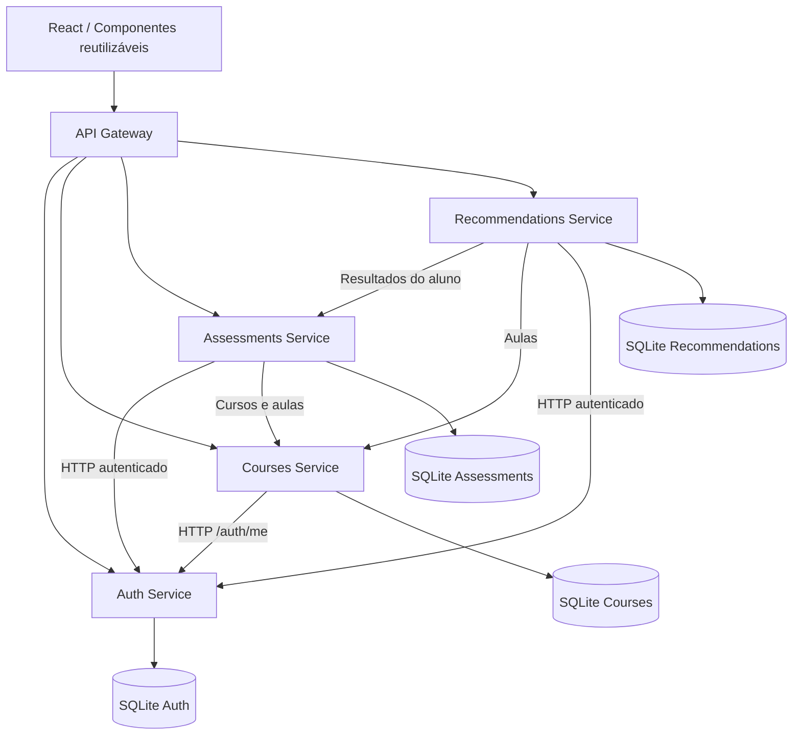

# MicroLearn — Ambiente Virtual de Aprendizagem

**Engenharia de Software 2026.2 | Versão consolidada após a Sprint 4**

O MicroLearn é um AVA acadêmico com microsserviços Python/FastAPI independentes, API Gateway REST, frontend React baseado em componentes e persistência SQLite separada por domínio. O desenvolvimento segue a modelagem e o Product Backlog preparados para a disciplina.

## Estado real do projeto

| Domínio | Implementado agora | Situação |
|---|---|---|
| Autenticação | Cadastro, login, JWT, perfil, administração de usuários e tela React do administrador | Backend testado; frontend compilado e carregado no navegador |
| Cursos | Catálogo, CRUD de cursos, publicação, aulas e matrículas | Funcional e testado na Sprint 2 |
| Avaliações | Questionários objetivos, gabarito protegido, uma tentativa, notas e resultados | Funcional e testado na Sprint 3 |
| Recomendações | Aulas de revisão para resultados inferiores a 7,0, com cache por aluno | Funcional e testado na Sprint 3 |
| API Gateway | Encaminhamento HTTP, JWT, estado dos serviços | Funcional e testado |
| Frontend React | Cadastro/login, catálogo, matrículas, aulas, editor de avaliações, respostas, notas e recomendações | Build de produção aprovado e Home validada no Chrome com a Gateway integrada |

**Validações executadas nesta entrega:** 24 testes Python aprovados novamente em 09/11/2026, smoke HTTP real entre a Gateway e quatro serviços aprovado (incluindo avaliação e recomendação), `npm run build` aprovado e Docker Compose validado. Os seis contêineres permaneceram ativos sem reinícios, os cinco serviços FastAPI ficaram saudáveis e a Gateway confirmou os quatro microsserviços. Um E2E pela API no Docker percorreu cadastro, promoção de professor, curso/aula/publicação, matrícula, avaliação com gabarito protegido, nota e recomendação; a Home React respondeu HTTP 200 e foi renderizada no Chrome.

## Sprint 4: administração de usuários, integração final e documentação

Nesta sprint foi acrescentada a tela **`/admin/usuarios`**, acessível ao perfil administrador. Ela permite consultar contas, autorizar professores e administradores, ativar/desativar usuários, com confirmação de alterações e bloqueio de autodesativação. As operações utilizam os endpoints `GET /api/v1/auth/users` e `PATCH /api/v1/auth/users/{user_id}` já implementados no Auth Service.

A página inicial ganhou o botão **Atualizar estado**, que consulta a Gateway em `/api/v1/status` para listar Autenticação, Cursos, Avaliações e Recomendações. Os registros de execução e os diagramas ficam em `docs/`, incluindo `VALIDACAO_SPRINT4.md`, `CHECKLIST_ENTREGA.md` e `API_ENDPOINTS.md`. O Docker Compose foi validado no Windows;

## Sprint 3: avaliações e recomendações

O professor acessa **/cursos/:id/avaliacoes** a partir de um curso seu, escolhe a aula relacionada ao conteúdo, cria um questionário objetivo (1 a 20 questões, de 2 a 5 alternativas e apenas uma resposta correta) e consulta as notas. O aluno já matriculado acessa a mesma rota para responder à avaliação. Há **uma tentativa por aluno e questionário**. A nota é calculada por `round(10 * acertos / total, 2)` e fica registrada no banco privado de Avaliações. Alunos acessam **/desempenho** para consultar suas notas e recomendações de aulas vinculadas à avaliação com nota **estritamente inferior a 7,0**.

**Endpoints novos (todos sob `/api/v1` na Gateway):**

| Método e caminho | Permissão / operação |
|---|---|
| POST `/assessments/courses/{course_id}/quizzes` | Professor autor do curso: cria questionário e define aula de revisão |
| GET `/assessments/courses/{course_id}/quizzes` | Professor autor ou aluno matriculado: lista questionários |
| GET `/assessments/quizzes/{quiz_id}` | Consultar questões sem divulgar o gabarito |
| POST `/assessments/quizzes/{quiz_id}/submit` | Aluno matriculado: envia respostas e recebe a nota |
| GET `/assessments/results/mine` | Aluno: somente suas notas |
| GET `/assessments/courses/{course_id}/results` | Professor autor: notas dos alunos do curso |
| DELETE `/assessments/quizzes/{quiz_id}` | Professor autor: exclui somente questionário sem respostas |
| GET `/recommendations/mine` | Aluno: consulta aulas sugeridas para notas abaixo de 7,0 |

**Exemplo de criação de questionário** (`POST /api/v1/assessments/courses/{course_id}/quizzes`, token de professor):

```json
{
  "title": "Avaliação sobre Python",
  "lesson_id": "UUID_DA_AULA_DO_CURSO",
  "questions": [
    {"statement": "Quanto é 2 + 2?", "options": ["3", "4", "5"], "correct_index": 1},
    {"statement": "Quanto é 3 + 3?", "options": ["5", "6", "7"], "correct_index": 1}
  ]
}
```

**Exemplo de resposta** (`POST /api/v1/assessments/quizzes/{quiz_id}/submit`, token de aluno): `{"answers":[1,0]}`. Uma resposta correta em duas questões retorna a nota 5,00 e gera recomendação de revisão na tela de desempenho. O campo `correct_index` nunca aparece no endpoint de consulta das questões. A validação de contas e matrículas ocorre por HTTP, sem que Avaliações ou Recomendações acessem os bancos dos outros serviços.

**Limitações da versão acadêmica:** avaliações são objetivas e imutáveis depois de criadas; questionários respondidos não podem ser excluídos; uma avaliação exige uma aula de revisão previamente cadastrada. A remoção de aulas/cursos não dispara uma exclusão distribuída de questões e notas (registros históricos podem permanecer no serviço Avaliações). O serviço Recomendações deixa de sugerir conteúdos inexistentes ou sem acesso, mas não há um processo de limpeza distribuída de dados. Em produção, isso exigiria uma política explícita de retenção, eventos de domínio e consistência eventual. O build e a Home da integração React foram validados no Docker e no Chrome; os fluxos completos por perfil ainda devem ser ensaiados no navegador antes da entrega final.

## 1. Executar no Windows (Docker Desktop)

Pré-requisitos: Docker Desktop com Docker Compose, acesso à internet para baixar imagens/dependências, navegador e PowerShell. O projeto pode ser executado também em Linux/macOS com comandos equivalentes.

Abra o PowerShell na pasta `microlearn`:

```powershell
Copy-Item .env.example .env
python -c "import secrets; print(secrets.token_urlsafe(48))"
notepad .env
```

Insira a chave aleatória gerada em `JWT_SECRET` no arquivo `.env` (substitua `ALTERE_ME`). Para demonstrar o perfil de professor, configure também uma conta administrativa inicial:

```ini
ADMIN_EMAIL=admin@microlearn.local
ADMIN_PASSWORD=coloque-aqui-uma-senha-forte
```

> Use credenciais locais de teste; **não versione `.env`**. Uma senha administrativa deve ter pelo menos 12 caracteres. Em ambiente didático, a conta administrativa é criada automaticamente no primeiro início se as variáveis estiverem preenchidas e esse e-mail ainda não existir.

Execute:

```powershell
docker compose up --build -d
docker compose ps
```

Se um antivírus ou proxy corporativo inspecionar HTTPS e o build falhar ao validar o certificado dos repositórios de dependências, exporte apenas a CA pública local em formato PEM para um arquivo ignorado, por exemplo `.certs/host-ca.crt`, defina `DOCKER_HOST_CA_FILE=./.certs/host-ca.crt` no `.env` e execute:

```powershell
docker compose -f docker-compose.yml -f docker-compose.ca.yml up --build -d
```

O arquivo de sobreposição fornece a CA somente durante as etapas de instalação do build e mantém a verificação TLS ativa. Não versione o certificado local nem use opções que desabilitem a validação HTTPS.

| Acesso | Endereço |
|---|---|
| Interface React | http://localhost:5173 |
| API Gateway Swagger | http://localhost:8000/docs |
| Saúde dos serviços | http://localhost:8000/api/v1/status |
| Catálogo público | http://localhost:8000/api/v1/courses |

As portas são publicadas apenas em `127.0.0.1`. Os quatro microsserviços são acessados pela Gateway e comunicam-se na rede interna do Compose. Para encerrar sem apagar os bancos, execute `docker compose down`; **`docker compose down -v` remove os volumes e seus dados**.

## 2. Demonstração dos perfis, cursos e matrículas

### 2.1. Criar conta e autorizá-la como professor

1. Acesse `http://localhost:5173/cadastro` e crie uma conta comum (Aluno).
2. Faça login como administrador pelo endpoint `POST /api/v1/auth/login` na Swagger ou PowerShell, usando as credenciais configuradas no `.env`.
3. Consulte `GET /api/v1/auth/users` com o token administrativo para identificar o `id` do aluno que será professor.
4. Utilize `PATCH /api/v1/auth/users/{id}`, passando `{"role":"teacher"}`, com token administrativo. Faça logout/login na interface com a conta promovida para receber o novo perfil.
5. Acesse `http://localhost:5173/professor/cursos` e crie um curso, inicialmente como rascunho.
6. Abra o curso, inclua uma ou mais aulas e clique em **Publicar curso**.

**Exemplo PowerShell para promoção de papel:**

```powershell
$admin = @{email='admin@microlearn.local'; password='SENHA_DE_ADMIN_DO_ENV'} | ConvertTo-Json
$loginAdmin = Invoke-RestMethod http://localhost:8000/api/v1/auth/login -Method Post -ContentType 'application/json' -Body $admin
$headers = @{Authorization="Bearer $($loginAdmin.access_token)"}
$usuarios = Invoke-RestMethod http://localhost:8000/api/v1/auth/users -Headers $headers
$usuarios | Format-Table id,name,email,role
# Substitua ID_DO_USUARIO pelo UUID retornado acima:
Invoke-RestMethod 'http://localhost:8000/api/v1/auth/users/ID_DO_USUARIO' -Method Patch -Headers $headers -ContentType 'application/json' -Body '{"role":"teacher"}'
```

O cadastro público sempre cria um aluno. Não é permitido escolher o papel de professor ou administrador no formulário público. **Na Sprint 4, a promoção também pode ser feita na interface:** entre como administrador e abra `http://localhost:5173/admin/usuarios`. A interface permite mudar o perfil e ativar/desativar contas, sem usar o Swagger.

### 2.2. Matrícula e acesso do aluno

1. Faça login com uma conta do perfil aluno.
2. Abra `/cursos` para visualizar apenas os cursos publicados.
3. Selecione um curso e clique em **Matricular-me**.
4. O conteúdo das aulas se torna acessível; a mesma matrícula não pode ser feita duas vezes.
5. Acesse **Meus cursos** para consultar todas as matrículas realizadas.

**Regras demonstráveis:** um professor não consegue editar cursos de outro docente; o aluno não pode criar cursos; aulas exigem vínculo com matrícula ou autoria; rascunhos não são exibidos no catálogo; permissões do usuário são revalidadas no Auth Service mesmo quando seu JWT ainda não expirou.

## 3. API REST de Cursos

Todos os endpoints abaixo começam com `http://localhost:8000/api/v1`. Os IDs são UUIDs. A Gateway recebe os pedidos e os encaminha ao serviço Cursos, que revalida a conta ativa e o perfil através de uma chamada HTTP ao Auth Service. O serviço Cursos **não lê o banco do Auth**.

| Método | Caminho | Perfil e finalidade |
|---|---|---|
| GET | `/courses` | Público: catálogo de cursos publicados |
| POST | `/courses` | Professor: criar curso rascunho |
| GET | `/courses/owned` | Professor: seus cursos |
| GET | `/courses/enrollments/mine` | Aluno: suas matrículas |
| GET | `/courses/{id}` | Autenticado: dados de curso publicado; rascunho somente para autor |
| PATCH | `/courses/{id}` | Professor autor: editar ou publicar curso |
| DELETE | `/courses/{id}` | Professor autor: excluir curso e seus vínculos |
| POST | `/courses/{id}/enrollments` | Aluno: realizar matrícula em curso publicado |
| GET | `/courses/{id}/lessons` | Professor autor ou aluno matriculado: listar e acessar aulas |
| POST | `/courses/{id}/lessons` | Professor autor: criar aula |
| PATCH | `/courses/{id}/lessons/{lesson_id}` | Professor autor: editar aula |
| DELETE | `/courses/{id}/lessons/{lesson_id}` | Professor autor: excluir aula |

Exemplo para criar um curso como professor (inclua seu JWT):

```json
{
  "title": "Fundamentos de Python",
  "description": "Introdução à programação com Python",
  "category": "Programação"
}
```

Exemplo para criar uma aula em `POST /courses/{id}/lessons`:

```json
{
  "title": "Variáveis e tipos de dados",
  "body": "Conteúdo textual da aula, com exemplos e exercícios.",
  "material_url": "https://www.python.org/doc/",
  "position": 1
}
```

Para publicar: `PATCH /courses/{id}` com `{"status":"published"}`. A matrícula é criada por `POST /courses/{id}/enrollments`, com JWT do aluno e corpo vazio.

Códigos HTTP relevantes: `200` sucesso; `201` criado; `204` removido; `401` credenciais inválidas; `403` perfil ou vínculo sem acesso; `404` recurso inexistente; `409` matrícula duplicada ou curso não publicado; `422` entrada inválida; `503` falha temporária da autenticação/rede.

## 4. Arquitetura e componentes reutilizáveis



A persistência do Courses Service contém três tabelas: `courses`, `lessons` e `enrollments`. O banco de cada serviço é independente. `enrollments` usa `UNIQUE(course_id, student_id)` e as relações de aulas/matrículas usam chaves estrangeiras com exclusão em cascata. O Courses armazena apenas `teacher_id` e `student_id` como identificadores, sem replicar tabelas de usuários.

Componentes compartilhados no React: `AppShell`, `Navbar`, `Alert`, `ProtectedRoute`, `CourseCard`, `CourseForm` e `LessonEditor`. `AuthContext` centraliza a sessão; `apiClient` centraliza a comunicação REST. As telas incluem `CoursesCatalog`, `TeacherCourses`, `MyEnrollments`, `CourseDetail`, `CourseAssessments`, `QuizDetail` e `StudentPerformance`, além das páginas da Sprint 1.

## 5. Testes e execução sem Docker

**Requisitos para testes:** Python 3.11+, pip e dependências do projeto.

```powershell
python -m venv .venv
.\.venv\Scripts\Activate.ps1
pip install -r backend/requirements.txt pytest
python -m pytest -q
python tests/smoke_processes.py
```

O smoke inicia 5 processos Python temporários nas portas `18100` a `18104`, com bancos SQLite temporários: Gateway, Auth, Courses, Assessments e Recommendations. Testa cadastro/login, promoção de professor, criação/publicação de curso e aula, matrícula, gabarito protegido, resposta a quiz, nota 5/10, tentativa duplicada, recomendação de aula, bloqueio de aluno não matriculado e revogação de privilégios. O processo não utiliza Docker.

Para desenvolver o React isolado com backend já executando:

```powershell
cd frontend
npm ci
npm run dev
```

**Nota:** o build de produção foi validado em 08/11/2026 e a Home servida pelo Docker foi carregada no Chrome em 09/11/2026. Registre também capturas dos fluxos completos de aluno, professor e administrador antes de entregar o trabalho.

## 6. Organização do repositório

```
microlearn/
├─ backend/
│  ├─ common/                  # JWT e utilitários reutilizados
│  ├─ gateway/                 # API Gateway
│  └─ services/
│     ├─ auth/                 # Auth + banco próprio
│     ├─ courses/              # CRUD de cursos/aulas/matrículas
│     ├─ assessments/          # Questionários, correção, tentativas e notas
│     └─ recommendations/      # Motor de recomendação por regras
├─ frontend/src/
│  ├─ components/              # Componentes reutilizáveis
│  ├─ context/                 # Sessão de autenticação
│  ├─ pages/                   # Páginas React
│  └─ services/                # Comunicação com Gateway
├─ tests/                      # pytest e smoke com processos reais
├─ docs/                       # Relatórios e evidências
├─ docker-compose.yml
├─ docker-compose.ca.yml       # CA local opcional para o build
├─ .env.example
└─ README.md
```

## 7. Limites e evolução

Esta aplicação é um protótipo acadêmico. Para uso público seriam necessários HTTPS, rate limiting, revogação de tokens, política de senhas/recuperação, prevenção reforçada contra XSS e uma revisão de concorrência/observabilidade. O frontend utiliza `sessionStorage` por simplicidade.

**Sprint 3 implementada:** avaliações objetivas, registro de respostas, correção automática, notas e recomendações de revisão.

**Sprint 4:** testes E2E, melhorias, documentação final, evidências Docker e publicação no GitHub.

## 7. Estado da Sprint 4 e entrega acadêmica

Para revisar os resultados obtidos no ambiente de geração:

```powershell
python -m pytest -q
python tests/smoke_processes.py
```

Os testes Python e HTTP confirmam o funcionamento dos cinco processos do backend; os 24 testes `pytest` passaram novamente em 09/11/2026. O frontend também foi instalado e compilado; durante essa validação, a configuração do runtime JSX foi corrigida para eliminar a tela em branco. Na mesma data, o Docker Compose construiu as seis imagens e iniciou os seis contêineres: os cinco backends ficaram saudáveis, a interface respondeu HTTP 200 e foi renderizada no Chrome, e os logs recentes não apresentaram erros nem respostas HTTP 5xx. O E2E pela API Docker validou cadastro de aluno e professor, promoção pelo administrador, criação e publicação de curso e aula, matrícula, questionário de duas questões sem exposição do gabarito, nota 5,0 (1/2), resultado e recomendação.

Use `docs/CHECKLIST_ENTREGA.md` para marcar evidências, `docs/API_ENDPOINTS.md` para a relação de endpoints e `docs/VALIDACAO_SPRINT4.md` para os resultados e limites da validação.

**GitHub:** https://github.com/Jader-Neto/MicroLearn.
