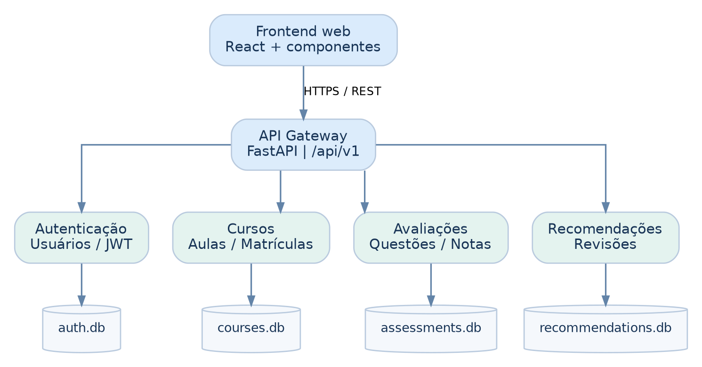
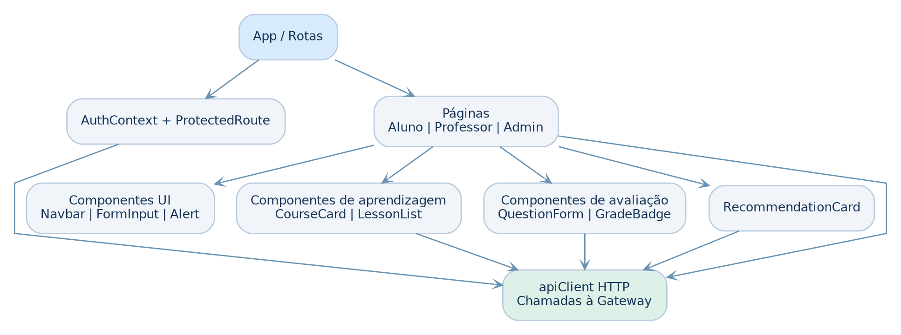
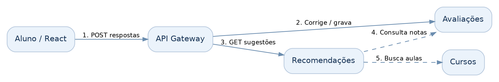

<div align="center">
  <h1>MicroLearn</h1>
  <p><strong>Ambiente Virtual de Aprendizagem com arquitetura de microsserviços</strong></p>
  <p>Uma plataforma acadêmica completa para administrar usuários, publicar cursos, organizar aulas, aplicar avaliações e recomendar conteúdos de revisão com base no desempenho do aluno.</p>
  <p>
    
    
    
    
    
  </p>
  <p>
    <a href="#visão-geral">Visão geral</a> •
    <a href="#arquitetura">Arquitetura</a> •
    <a href="#funcionalidades">Funcionalidades</a> •
    <a href="#como-executar">Executar</a> •
    <a href="#qualidade-e-testes">Testes</a> •
    <a href="#documentação">Documentação</a>
  </p>
</div>

---

## Visão geral

O MicroLearn foi desenvolvido para a disciplina de **Engenharia de Software 2026.2**. A solução combina um frontend React com uma API Gateway e quatro serviços de negócio independentes, todos executados por Docker Compose.

| Perfil | Experiência na plataforma |
|---|---|
| **Aluno** | Consulta o catálogo, realiza matrículas, acessa aulas, responde avaliações e acompanha notas e recomendações. |
| **Professor** | Cria cursos e aulas, publica conteúdos, elabora questionários e consulta resultados dos alunos. |
| **Administrador** | Gerencia contas, autoriza professores, altera perfis e ativa ou desativa usuários. |

### Principais entregas

- Autenticação JWT e autorização por perfil;
- catálogo público de cursos, publicação, aulas e matrículas;
- avaliações objetivas com gabarito protegido e correção automática;
- histórico de resultados e recomendação de revisão para notas abaixo de 7,0;
- administração de usuários pela própria interface;
- monitoramento da saúde dos serviços pela API Gateway;
- persistência SQLite independente por domínio;
- build reproduzível e execução completa com Docker Compose.

## Arquitetura

A aplicação segue uma arquitetura de microsserviços: o navegador acessa somente o frontend e a API Gateway; cada domínio mantém sua própria API e seu próprio banco de dados.

<p align="center">
  
</p>

| Camada | Responsabilidade |
|---|---|
| **Frontend React** | Interface responsiva, rotas protegidas e experiências específicas para aluno, professor e administrador. |
| **API Gateway** | Ponto de entrada REST, encaminhamento de requisições, CORS e visão consolidada da saúde dos serviços. |
| **Auth Service** | Cadastro, login, JWT, perfis e administração de usuários. |
| **Courses Service** | Cursos, aulas, publicação e matrículas. |
| **Assessments Service** | Questionários, questões, tentativas, correção e notas. |
| **Recommendations Service** | Sugestões determinísticas de revisão com base nos resultados. |
| **Persistência** | Um banco SQLite e um volume por domínio, sem compartilhamento direto de tabelas. |

### Decisões de projeto

- A Gateway é a única entrada para as APIs externas em `/api/v1`.
- Os serviços validam permissões e vínculos por HTTP, sem consultar bancos de outros domínios.
- O cadastro público sempre cria um aluno; somente um administrador pode promover outros perfis.
- O gabarito nunca é devolvido ao aluno nos endpoints de consulta.
- As portas externas são publicadas apenas em `127.0.0.1`.

<details>
<summary><strong>Ver organização dos componentes React</strong></summary>

<br>

<p align="center">
  
</p>

O `AuthContext` concentra a sessão, `ProtectedRoute` controla o acesso por perfil e `apiClient` centraliza a comunicação com a Gateway. Componentes como `AppShell`, `Navbar`, `Alert`, `CourseCard`, `CourseForm` e `LessonEditor` são reutilizados entre as telas.

</details>

<details>
<summary><strong>Ver fluxo de avaliação e recomendação</strong></summary>

<br>

<p align="center">
  
</p>

Após a tentativa, o serviço de Avaliações registra a nota. Resultados inferiores a 7,0 originam uma recomendação de aula de revisão, sempre respeitando matrícula e acesso ao conteúdo.

</details>

## Funcionalidades

### Autenticação e administração

- cadastro e login com JWT;
- consulta do perfil autenticado;
- listagem administrativa de usuários;
- promoção para professor ou administrador;
- ativação e desativação de contas;
- bloqueio de autodesativação do administrador.

### Cursos e aprendizagem

- catálogo público de cursos publicados;
- criação e edição de cursos em rascunho;
- publicação controlada pelo professor autor;
- aulas com conteúdo textual, posição e material complementar;
- matrícula única por aluno e curso;
- acesso às aulas somente por autoria ou matrícula.

### Avaliações e desempenho

- questionários de 1 a 20 questões;
- questões com 2 a 5 alternativas e uma resposta correta;
- uma tentativa por aluno e questionário;
- correção automática na escala de 0 a 10;
- gabarito protegido nas consultas do aluno;
- resultados individuais e visão do professor por curso;
- recomendações explicáveis de conteúdo para revisão.

## Como executar

### Pré-requisitos

- Docker Desktop com Docker Compose;
- navegador atualizado;
- acesso à internet no primeiro build.

### 1. Clonar e configurar

No PowerShell:

```powershell
git clone https://github.com/Jader-Neto/MicroLearn.git
cd MicroLearn
Copy-Item .env.example .env
python -c "import secrets; print(secrets.token_urlsafe(48))"
notepad .env
```

Substitua `ALTERE_ME` pela chave gerada e, para habilitar o administrador inicial, preencha:

```ini
JWT_SECRET=chave-aleatoria-gerada
CORS_ORIGINS=http://localhost:5173
ADMIN_EMAIL=admin@microlearn.local
ADMIN_PASSWORD=coloque-aqui-uma-senha-forte
```

> Use apenas credenciais locais de demonstração. O arquivo `.env` é ignorado pelo Git e não deve ser versionado.

### 2. Iniciar a aplicação

```powershell
docker compose up --build -d
docker compose ps
```

Quando os serviços estiverem prontos, a listagem deve apresentar cinco backends saudáveis e o frontend em execução.

### 3. Acessar

| Recurso | Endereço |
|---|---|
| **Interface web** | http://localhost:5173 |
| **Swagger da Gateway** | http://localhost:8000/docs |
| **Estado dos serviços** | http://localhost:8000/api/v1/status |
| **Catálogo público** | http://localhost:8000/api/v1/courses |

Para encerrar sem excluir os bancos:

```powershell
docker compose down
```

> `docker compose down -v` também remove os volumes e todos os dados locais.

<details>
<summary><strong>Build em rede com inspeção HTTPS</strong></summary>

Se um antivírus ou proxy inspecionar HTTPS e o build não reconhecer a cadeia de certificados, exporte somente a CA pública local em formato PEM para `.certs/host-ca.crt`, adicione ao `.env`:

```ini
DOCKER_HOST_CA_FILE=./.certs/host-ca.crt
```

E execute:

```powershell
docker compose -f docker-compose.yml -f docker-compose.ca.yml up --build -d
```

A CA é fornecida somente durante a instalação de dependências no build. A validação TLS permanece ativa e o certificado local continua fora do versionamento.

</details>

## Fluxo de demonstração

1. Crie uma conta pelo formulário público; ela receberá o perfil de aluno.
2. Entre como administrador e abra `/admin/usuarios`.
3. Promova uma segunda conta para professor.
4. Entre como professor, crie um curso, adicione uma aula e publique o conteúdo.
5. Entre como aluno, abra o catálogo e realize a matrícula.
6. Como professor, crie um questionário associado à aula.
7. Como aluno, responda à avaliação e consulte `/desempenho`.
8. Verifique a nota e, quando inferior a 7,0, a recomendação de revisão.

## API e segurança

A base externa da API é `http://localhost:8000/api/v1`. A documentação completa dos contratos está em [docs/API_ENDPOINTS.md](docs/API_ENDPOINTS.md), e o Swagger interativo fica disponível em `/docs` enquanto a aplicação estiver em execução.

| Proteção | Implementação |
|---|---|
| **Autenticação** | JWT assinado com segredo configurado fora do código. |
| **Autorização** | Perfis e estado da conta são revalidados nas operações protegidas. |
| **Isolamento** | Cada microsserviço possui banco e volume próprios. |
| **Avaliações** | O gabarito não aparece nos dados enviados ao aluno. |
| **Segredos** | `.env`, certificados locais, bancos e artefatos de build estão ignorados no Git. |

## Qualidade e testes

O projeto foi validado tanto fora quanto dentro do Docker.

| Verificação | Resultado |
|---|---|
| Testes automatizados Python | **24 aprovados** |
| Smoke test com processos HTTP reais | **Gateway + 4 serviços aprovados** |
| Build de produção React/Vite | **Aprovado** |
| Docker Compose | **6 contêineres em execução** |
| Health checks | **5 backends saudáveis** |
| E2E pela API Docker | **Cadastro → curso → matrícula → avaliação → nota → recomendação** |
| Renderização no Chrome | **Interface carregada sem erros** |

Para executar localmente sem Docker:

```powershell
python -m venv .venv
.\.venv\Scripts\Activate.ps1
pip install -r backend/requirements.txt pytest
python -m pytest -q
python tests/smoke_processes.py
```

Para trabalhar apenas no frontend com o backend já iniciado:

```powershell
cd frontend
npm ci
npm run dev
```

Os resultados e limites de cada verificação estão registrados em [docs/VALIDACAO_SPRINT4.md](docs/VALIDACAO_SPRINT4.md).

## Tecnologias

| Área | Tecnologias |
|---|---|
| Frontend | React 19, React Router 7, Vite 6, CSS |
| Backend | Python 3.12, FastAPI, Uvicorn, Pydantic |
| Autenticação | JWT, PBKDF2-HMAC-SHA256 |
| Persistência | SQLite, volumes Docker independentes |
| Infraestrutura | Docker Desktop, Docker Compose, Nginx |
| Testes | pytest, TestClient, smoke HTTP e E2E pela API |

## Estrutura do repositório

```text
MicroLearn/
├── backend/
│   ├── common/                  # Segurança e utilitários compartilhados
│   ├── gateway/                 # API Gateway
│   └── services/
│       ├── auth/                # Usuários, JWT e administração
│       ├── courses/             # Cursos, aulas e matrículas
│       ├── assessments/         # Questionários, tentativas e notas
│       └── recommendations/     # Recomendações de revisão
├── frontend/
│   ├── src/components/          # Componentes reutilizáveis
│   ├── src/context/             # Sessão e autenticação
│   ├── src/pages/               # Páginas por fluxo e perfil
│   └── src/services/            # Cliente da API Gateway
├── tests/                       # Testes automatizados e smoke HTTP
├── docs/                        # Diagramas, contratos e evidências
├── docker-compose.yml           # Orquestração principal
├── docker-compose.ca.yml        # CA local opcional para o build
└── .env.example                 # Modelo de configuração
```

## Documentação

| Documento | Conteúdo |
|---|---|
| [Contratos da API](docs/API_ENDPOINTS.md) | Relação dos endpoints externos e regras de segurança. |
| [Validação final](docs/VALIDACAO_SPRINT4.md) | Evidências de testes, Docker, navegador e E2E. |
| [Checklist de entrega](docs/CHECKLIST_ENTREGA.md) | Itens implementados e evidências acadêmicas. |
| [Arquitetura em Mermaid](docs/arquitetura.mmd) | Fonte editável do diagrama principal. |
| [Relatório técnico final](docs/MicroLearn_Etapa_8_Sprint_4_Validacao_e_Documentacao.pdf) | Consolidação da implementação e validação. |

Os relatórios das etapas anteriores também permanecem disponíveis na pasta [docs/](docs/).

## Limitações conhecidas

O MicroLearn é um protótipo acadêmico funcional. Para uma implantação pública ainda seriam necessários HTTPS no ambiente final, recuperação de senha, rate limiting, revogação de tokens, observabilidade e uma política explícita de retenção de dados.

As avaliações são objetivas e imutáveis após a criação, cada aluno possui uma tentativa por questionário e a exclusão de cursos não executa uma transação distribuída para apagar históricos em outros serviços. O recomendador atual é determinístico e explicável; não utiliza inteligência artificial.

---

<div align="center">
  <p><strong>MicroLearn — aprender, ensinar e evoluir em um só lugar.</strong></p>
  <p>Engenharia de Software • 2026.2</p>
</div>
